<div align="center">

# NetSpider

### Guided Wi-Fi handshake capture and password-cracking workflow for labs and authorized testing.

A Python front-end for the Aircrack-ng suite that chains the usual manual steps — scan, capture, deauthenticate, crack — into one step-by-step terminal workflow.


-2e7d32?style=for-the-badge)


</div>

<div align="center">

</div>

---

<div align="center">

</div>

## Overview

The Aircrack-ng workflow normally means remembering a chain of separate commands in the right order. NetSpider walks you through them from a single flow: it verifies the adapter, manages monitor mode, scans for networks, captures a handshake from a chosen access point, and hands the capture off for cracking. It is meant for **your own lab**, CTF practice, and engagements you are authorized to run.

Version **2.0** is a full rewrite of the original single-file script into a clean, modular package — with **runtime monitor-interface detection** (the fix for the classic `wlan0` vs `wlan0mon` problem), a parsed network picker, and tidier output handling. The banner and colors are byte-for-byte identical to the original.

---

## Methodology

<div align="center">

</div>

1. **Monitor** — verify the adapter, enable monitor mode with `airmon-ng`, then **detect the real monitor interface** (`wlan0`, `wlan0mon`, …) from the system instead of assuming a fixed name.
2. **Scan** — run `airodump-ng`, then parse the results into a numbered list of nearby access points.
3. **Select** — pick a target by number, or enter the BSSID/channel manually.
4. **Capture** — listen on the target channel while sending `aireplay-ng` deauth frames to prompt a reconnection and capture the WPA handshake.
5. **Crack** — validate the handshake and attempt a wordlist-based crack with `aircrack-ng` (resumable deep search via crunch + John).

---

## What's New in 2.0

- **Interface auto-detection** — after `airmon-ng start`, the real monitor interface is detected at runtime (via `iw` / `iwconfig`). No more silent failures when the adapter becomes `wlan0mon`.
- **Network picker** — the scan is parsed into a numbered list (ESSID · BSSID · channel · signal); manual entry still available.
- **No GUI-terminal dependency** — the attack no longer needs `gnome-terminal` or a world-readable script in `/tmp`; it runs in the same terminal.
- **Tidy output** — captures, keys and session files are collected under a `captures/` folder.
- **Input validation** — BSSID, channel and capture name are validated; the listening command runs without a shell (no command injection).
- **Installable package** (`pip install .` → `sudo netspider`).

The attack logic itself (deauth → handshake → wordlist crack) is unchanged from the original — only reliability and ergonomics were improved.

---

## Architecture

```
netspider/
├── cli.py              # main flow
├── config.py           # settings (interface, capture dir)
├── ui/
│   ├── colors.py       # ANSI palette (identical to original)
│   ├── banner.py       # ASCII banner (identical to original)
│   └── animation.py    # intro animation
├── core/
│   ├── adapter.py      # root check, monitor mode, interface detection
│   ├── scanner.py      # network discovery + parsing
│   ├── attack.py       # handshake capture + crack flow
│   └── process.py      # subprocess helpers, cleanup
├── utils/
│   ├── validators.py   # BSSID / channel / name validation
│   └── airodump.py     # airodump CSV parser
└── data/
    └── common_passwords.txt   # bundled quick wordlist
```

---

## Requirements

| Component | Notes |
|---|---|
| Python 3.8+ | Standard library only — **no pip packages** |
| Aircrack-ng suite | `airmon-ng`, `airodump-ng`, `aireplay-ng`, `aircrack-ng` |
| wireless-tools / iw | Interface detection and management |
| crunch, john | Deep wordlist generation / cracking |
| Compatible Wi-Fi adapter | Must support monitor mode and packet injection |
| Linux + root | Required for monitor mode and injection |

```bash
sudo apt-get install -y aircrack-ng wireless-tools crunch john network-manager
```

---

## Installation & Usage

```bash
git clone https://github.com/osmnabyram/Siber-NetSpider.git
cd Siber-NetSpider

sudo python3 run.py
```

…or install it as a command:

```bash
pip install .
sudo netspider
```

> Root is required for monitor mode and packet injection.

---

## Responsible Use

NetSpider is for **education, CTF competitions, lab setups, and authorized penetration testing only**. Capturing handshakes, deauthenticating clients, or cracking passwords on networks you do not own or are not explicitly authorized to test is illegal and unethical. The author accepts no responsibility for misuse.
